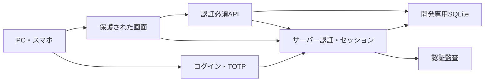
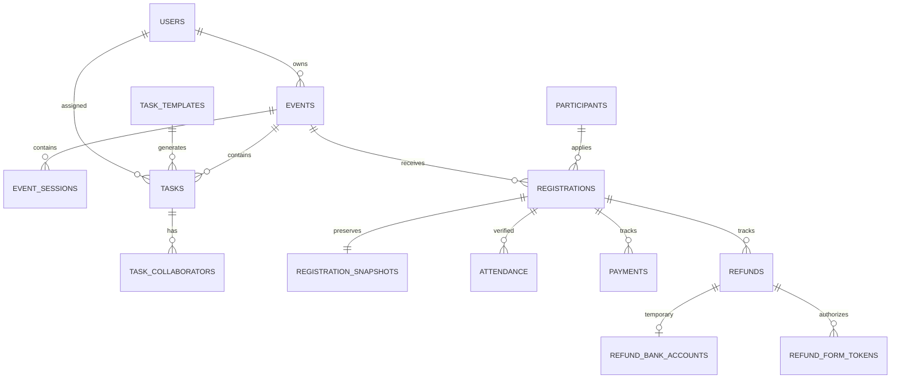

# 構成・費用・データモデル（採用未確定）

## 既存構成と第1〜4段階

Next.js 16.2.4 App Router、React 19、TypeScript、Tailwind、better-sqlite3。Node.js 24.19.0／npm 11.9.0で検証する。依存関係は`npm ci`で固定する。

- `app/login`：開発用ログインとMFA登録／照合。
- `app/(protected)`：サーバー側セッション照合、ホーム、既存セミナー画面。URLに括弧内は現れない。
- `app/api/auth/[action]`：login／mfa／logout（POSTのみ）。
- `app/api/seminars`：すべてのハンドラーでDBアクセス前に認証と変更操作のOriginを検査。
- `lib/auth-store.ts`：Nodeの暗号処理とSQLiteに依存する暫定ローカル認証アダプター。
- `lib/development.ts`：環境の明示指定と保存領域の分離。本番値・未指定は拒否。
- `proxy.ts`：キャッシュ抑止と保護ヘッダー。認可をProxyだけに依存させない。
- `lib/event-store.ts`：イベント・開催回・テンプレート・タスク・協力者・業務監査の開発用DBアダプター。保存と監査を同じトランザクションで処理。
- `components/EventForms.tsx`：作成・編集フォーム。失敗・競合時はエラーを表示し、日程プレビューには適用ボタンを設けない。
- `lib/registration-store.ts`：参加者マスター・申込・不変の申込時情報・代表情報の変更履歴。照合・再試行・監査を即時トランザクションで処理する。
- `components/RegistrationForms.tsx`：手動申込、代表情報編集、本文による検索・ページ送り。検索語や連絡先をURLへ入れない。

## 本番候補の比較・費用検証

| 候補 | 利点／比較点 | 採用前に確認すること |
|---|---|---|
| Next.js＋Supabase/PostgreSQL＋Vercel等 | マネージド認証・DB、保守負担軽減の候補 | 商用条件、管理者MFA、権限、30日バックアップと復元、2名承認のプラン条件 |
| Next.js＋マネージドPostgreSQL＋別認証サービス | 認証やDBを個別に選べる | 総費用、接続数、秘密保管、複数サービスの障害対応 |
| 低コストサーバー＋DB／認証の運用 | 構成の自由度 | パッチ、監視、冗長化、バックアップと鍵管理を2名で継続できるか |

月額目標は3,000〜5,000円。料金試算は**未実施／未確定**。現在のSQLiteでこの予算や本番安全性を保証しない。比較時には公式料金ページの確認日、通貨・為替・税、対象プラン、使用量を記録する。

見積項目：ホスティング＋DB＋認証/MFA＋ログ＋暗号化バックアップと復元＋メール送信量＋LINEメッセージ量＋ドメイン。無料枠だけで満たせると推定しない。管理者2名が条件を確認して採用判断する。

## データモデル

今回追加する実テーブル：`users`（パスワードハッシュ、暗号化MFA秘密、最後の使用ステップ）、`sessions`（トークンのハッシュ・失効時刻）、`auth_challenges`（暗号化秘密・有効期限・失敗数）、`auth_attempts`（主体ハッシュ・失敗数・ロック期限）、`audit_logs`（内部ユーザーID・操作種別・時刻）。秘密値を監査へ書かない。

論理モデル（原文13.2の提案）：第2段階ではevents、event_sessions、task_templates、tasks、task_collaborators、event_audit_logsを追加した。第3段階はparticipant_masters、registrations、registration_snapshots、registration_match_candidates、participant_contact_histories、participant_audit_logsを追加。出欠・会計以下は今後の実装。

追加関連：連絡先履歴、待機者、講師・提出物、フォーム定義、取り込みジョブと原本行、メールoutbox、カレンダーID、通知ジョブ、不具合・改善要望、外部接続状態。外部同期は原本識別子の複合一意制約とトランザクションで冪等性を確保する。

## APIと移行の計画

今回のAPIはログイン→MFA→セッション発行→保護された既存CRUD→ログアウト。認証後ホームを`/`、旧一覧を`/seminars`へ移した。認証API以外の業務APIは認証必須。

今後は原文13.3に沿って`/api/events`、`/api/tasks/{id}`、申込／参加者／会計、取り込みpreview/execute、メールpreview、通知へ拡張する。副作用のある外部APIは本番接続検証と人の承認前には実装を有効化しない。

第2段階追加API：`GET/POST /api/events`、`GET/PATCH /api/events/{id}`（PATCHは責任者とバージョンのみ）、`GET/POST /api/events/{id}/tasks`、`GET /api/events/{id}/history`、`POST /api/events/{id}/schedule-preview`（読取りのみ）、`PATCH /api/tasks/{id}`、`GET/POST /api/task-templates`、`PATCH /api/task-templates/{id}`、`GET /api/members`（ID・表示名のみ）。全て認証必須、変更系とプレビューは同一Origin必須。競合409、入力400、不在404を返す。

第3段階追加API：`GET /api/participants?page=1`、`POST /api/participants/search`（query/pageを本文で送信）、`GET/PATCH /api/participants/{id}`（PATCHはversion/contact）、`GET/POST /api/events/{id}/registrations`（POSTはrequest_key/snapshot）。同じ認証・Origin保護を適用し、エラーには個人情報を含めない。GETの検索語パラメーターは拒否する。

手動登録のsource_typeはMANUALで、UUIDを一意キーにする。外部取込は未実装であり、将来は外部サービス・原本ID・原本行IDの複合キーへ拡張する。申込の状態CHECKは現段階では受付確認待ちのみを許可するため、受付・待機・キャンセルの実装時に明示的なスキーマ移行が必要。

第4段階では破壊的なテーブル再作成を避け、`registration_confirmations`と`admission_audit_logs`を追加した。元のregistrations列は記録時の受付確認待ちを保持し、APIの有効状態はLEFT JOINした席確保の有無から`CONFIRMED/PENDING_REVIEW`を導出する。状態フィルターや集計も席確保テーブルを用いる。`registrations.application_status`を単独参照して確定数を数えない。

席確保は登録IDを主キー、イベント＋参加者を一意とし、元の申込との複合外部キーで整合性を守る。BEGIN IMMEDIATEで直列化し、確定済み件数を残席判定に使う。DBトリガーは定員超過の席挿入と確定数以下への不正な定員変更を防ぐ。締切はサーバー時刻で判定し、最後の確認時刻を確定時刻として保存する。

追加API：`GET/PATCH /api/events/{id}/admission`（PATCHはcapacity/event_version）、`POST /api/registrations/{id}/confirm`（reviewed=true/event_version）。全て認証必須、変更系は同一Origin必須。競合・満席・締切・定員未設定は409、確認不足400、不在404。確定済みの成功リトライは締切後や満席時にも既存結果を返す。

旧`data/seminars.db`は読み取らず、コピー／自動移行しない。新DBは`data/development/seminars.db`、テストは`data/test/<実行ID>/seminars.db`。スキーマは空DBへの冪等作成から開始する。将来の移行はバージョン管理、バックアップ、架空データでの復元試験、ドライラン、管理者確認を経て行う。旧participantsはイベント別レコードなので、マスターと申込への変換時にも本人同定や出席を推定しない。
